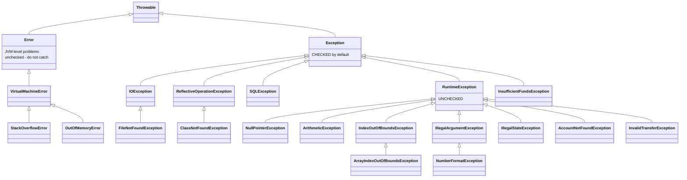

# Java Exception Cheat Sheet

## 1. Fundamentals, with analogies

| Concept | Simple explanation | Analogy for the presentation |
|---|---|---|
| **Exception** | An object that represents an abnormal event. It is *thrown* to stop normal execution and *caught* by code that knows how to respond. | A card machine showing "DECLINED": the purchase stops and the cashier follows a procedure. |
| **Error** | A serious problem with the **JVM or environment** (out of memory, stack overflow). Applications normally cannot recover. | The shop's power goes out. The cashier can't "handle" that at the till. |
| **Checked exception** | Subclass of `Exception` but **not** of `RuntimeException`. The **compiler** forces callers to catch it or declare `throws`. Used for foreseeable failures outside your control. | A parcel that needs a signature: the courier *must* get someone to deal with it. |
| **Unchecked exception** | Subclass of `RuntimeException`. Not enforced by the compiler. Usually a bug or invalid input. | Tripping over your own shoelace. No form to fill in. Tie your laces (prevention). |
| **Throwable** | The root class. Only `Throwable`s can be thrown or caught. | The "incident report" form every problem is written on. |
| **Interrupting execution** | When a statement throws, the rest of the block is **skipped** immediately. | A fire alarm: everybody stops what they are doing mid-sentence. |
| **Unhandled exception** | If no frame catches it, the thread dies and the stack trace is printed. For `main`, the program exits with code 1. | A complaint escalated past the manager and the CEO with nobody resolving it: the shop closes. |
| **Propagation** | The exception travels **up the call stack**, from callee to caller, until a matching `catch` is found. | A problem escalated cashier → supervisor → manager until someone has the authority to resolve it. |
| **Stack unwinding** | As it propagates, each frame without a matching catch is popped. Its `finally` runs and its remaining statements never run. | Leaving a building during a fire drill: each floor is emptied as you go down, and nobody finishes their meeting. |
| **Why not catch `Error`** | The JVM may be in an inconsistent state (no memory, corrupt stack). "Handling" it usually hides the real problem or fails again. | Don't try to keep serving customers during a power cut. Let the building's safety system act. |

## 2. The hierarchy

The rule the compiler uses: **`RuntimeException`, `Error` and their subclasses are unchecked. Every other `Throwable` is checked.**
`ExceptionHierarchyDemo` prints these chains from the JVM itself using `getSuperclass()`.

## 3. Catalogue of the demonstrated exceptions

All examples are in `src/main/java/com/example/exceptions/examples/`. Line numbers are where the exception is thrown. Put the breakpoint there, or on the line before.

| Exception | Kind | Trigger (file:line) | Why Java throws it | Prevent / handle | Inspect in debugger |
|---|---|---|---|---|---|
| `NullPointerException` | unchecked | `UncheckedExceptionExamples:58` `customer.email().toLowerCase()` | Calling a method on a `null` reference; there is no object to call it on | `Optional.ofNullable`, null checks, `Objects.requireNonNull` at boundaries | `customer` → `email = null`. The helpful-NPE message names the null expression. |
| `ArithmeticException` | unchecked | `UncheckedExceptionExamples:69` `totalPence / people` | Integer division by zero has no defined result (floating point gives `Infinity` instead) | Validate the divisor (`people <= 0`) | `people = 0` |
| `ArrayIndexOutOfBoundsException` | unchecked | `UncheckedExceptionExamples:87` `arr[arr.length]` | Valid indexes are `0..length-1`. Java checks every array access. | Use `length - 1`, check for empty arrays, prefer lists/streams | `lastThreeTransactions.length = 3`, index 3 |
| `NumberFormatException` | unchecked (subclass of IAE) | `UncheckedExceptionExamples:101` `new BigDecimal("12,50")` | The text is not a valid number format (comma decimal) | Validate the format; catching it while parsing user input is acceptable | `amountFromCsv = "12,50"` |
| `IllegalArgumentException` | unchecked | `UncheckedExceptionExamples:120` `amount.setScale(2, 42)` | The JDK validates its arguments: 42 is not a valid rounding mode | Pass valid values (use the `RoundingMode` enum); validate your own method arguments | Step into `setScale` to see the JDK's check |
| `IllegalStateException` | unchecked | `UncheckedExceptionExamples:148` `card.charge(...)` on inactive card | The *arguments* are fine but the *object* is in the wrong state | Check state first (`isActive()`), design objects so invalid states are impossible | `this.active = false` |
| `FileNotFoundException` | checked (subclass of IOException) | `CheckedExceptionExamples:54` `new FileReader(file)` | The OS cannot open the file (missing, or a directory) | `Files.exists` checks are racy, so catch and respond. Declare `throws` if the caller decides. | `file` path, `file.toAbsolutePath()` |
| `IOException` | checked | `CheckedExceptionExamples:67` `Files.readString(directory)` | Any I/O failure: permissions, disk, network, reading a directory | try-with-resources; translate to a domain exception or HTTP status | Exception subclass (e.g. `AccessDeniedException` on Windows) |
| `SQLException` | checked | `CheckedExceptionExamples:80` `DriverManager.getConnection("jdbc:corebank:...")` | No JDBC driver accepts that URL, so "No suitable driver found", SQLState `08001`. In real life: bad SQL, lost connection, constraint violation. | Correct config; translate to a domain/data-access exception (Spring does this with `DataAccessException`) | `e.getSQLState()`, `e.getErrorCode()` |
| `ClassNotFoundException` | checked | `CheckedExceptionExamples:91` `Class.forName("...LegacySwiftGateway")` | Loading by *name* at runtime cannot be checked by the compiler | Correct the class name or classpath; catch and give a clear configuration error | `className` |
| `StackOverflowError` | **Error** | `ErrorExamples:44` recursion with no base case | Each call adds a frame; the thread's fixed-size stack fills up | Add a base case; use iteration for deep loops. **Don't catch** in real code. | Frames panel: hundreds of identical frames |
| `OutOfMemoryError` | **Error** | `ErrorExamples:60` `new long[Integer.MAX_VALUE]` | The array is bigger than the JVM can ever allocate (refused up front, so it's safe) | Fix leaks, size caches, stream large data, tune `-Xmx`. **Don't catch.** | Message: `Requested array size exceeds VM limit` |

**"What happens when it is not handled?"** For every row: the exception propagates out of the method, then out of `main` (or up to Spring's `DispatcherServlet`). In a plain program the thread prints `Exception in thread "main" ...` and exits with code 1 (see `UnhandledExceptionDemo`). In this Spring app, the global handler turns it into an HTTP response; unknown types become a 500.

## 4. Keywords at a glance

| Keyword | What it is | Example in project |
|---|---|---|
| `try` | Block whose exceptions you want to handle or clean up after | `TryCatchDemo.describeRepayment` |
| `catch (T e)` | Runs if a `T` (or subclass) is thrown in the try. First match wins, top to bottom. | `MultipleCatchDemo.process` |
| `finally` | Always runs on leaving the try (normal, return, or exception), except abnormal JVM termination | `FinallyDemo.processPayment` |
| `throw expr` | **Statement**: throws one exception object now | `TransactionValidator.ensureSufficientFunds` |
| `throws T1, T2` | **Method signature**: declares exceptions that may propagate | `AccountService.withdraw(...) throws InsufficientFundsException` |
| `try (Res r = ...)` | try-with-resources: auto-closes `AutoCloseable`s in reverse order | `StatementService.loadStatement`, `TryWithResourcesDemo` |
| `catch (A \| B e)` | Multi-catch for unrelated types with the same handling | `MultipleCatchDemo` |
| `new X(msg, cause)` | Exception chaining: keeps the root cause | `ExceptionChainingDemo.settlePayment` |

## 5. Comparison tables

### Checked vs unchecked

| | Checked | Unchecked |
|---|---|---|
| Superclass | `Exception` (not `RuntimeException`) | `RuntimeException` (or `Error`) |
| Compiler enforces handling | ✅ catch or declare | ❌ |
| Typical meaning | Foreseeable failure outside your control | Bug or invalid input |
| Examples | `IOException`, `SQLException`, `InsufficientFundsException` | `NullPointerException`, `IllegalArgumentException`, `AccountNotFoundException` |
| Best response | Handle where you can do something useful, or declare/translate | Prevent with validation; let a top-level handler report it |
| Downside | Verbose signatures; doesn't work well with lambdas/streams | Easy to forget it can happen |

### Exception vs Error

| | `Exception` | `Error` |
|---|---|---|
| Source | Application logic, I/O, input | JVM / environment |
| Recoverable? | Usually | Usually not |
| Should you catch? | Yes, specific types | No (except very top-level logging/shutdown frameworks) |

### `throw` vs `throws`

| | `throw` | `throws` |
|---|---|---|
| Where | Inside a method body | In the method signature |
| Followed by | One exception **object** | One or more exception **types** |
| Purpose | Raise an exception now | Warn callers it may propagate |
| Needed for unchecked? | Yes, to throw | Optional (documentation only) |

### Java exception vs HTTP status

| | Java exception | HTTP status |
|---|---|---|
| Lives in | The JVM, inside one process | The HTTP response sent over the network |
| Audience | Developers (stack trace, cause) | Clients (status code + safe message) |
| Example | `InsufficientFundsException` | `409 Conflict` |
| Translation | `GlobalExceptionHandler` maps one to the other | |

### Status codes used

| Status | Meaning | Mapped from |
|---|---|---|
| 400 Bad Request | Client sent invalid data | `InvalidTransferException`, `IllegalArgumentException` (incl. `NumberFormatException`), malformed JSON |
| 404 Not Found | Resource doesn't exist | `AccountNotFoundException`, unknown path, missing statement (local) |
| 405 Method Not Allowed | Wrong HTTP verb | `HttpRequestMethodNotSupportedException` |
| 409 Conflict | Valid request, but conflicts with the current state | `InsufficientFundsException` |
| 500 Internal Server Error | Our bug | any other `Exception` |
| 503 Service Unavailable | Dependency failed | `IOException` in the statement demo (local) |

## 6. Best practices

1. **Catch specific types**, as close as possible to where you can do something *useful*.
2. **Never swallow** (`catch (Exception e) {}`). At least log with the exception: `log.error("msg", e)`.
3. **Prefer prevention** (validate, null-check, `Optional`) over catching unchecked exceptions.
4. **Don't use exceptions for normal control flow.** Return `Optional`/boolean for expected "no result" cases (`AccountService.findAccount`).
5. **Chain** when translating: `throw new DomainException("...", e)`.
6. **Close resources with try-with-resources.**
7. **Fail fast**: validate inputs at the start of a method, before changing state.
8. **Meaningful messages** with context (ids, amounts), but **no secrets** (passwords, full card numbers, balances in client responses).
9. **Log once**, at the place where the exception is handled. Logging at every layer gives duplicate stack traces.
10. **Never expose stack traces** to API clients.
11. **Custom exceptions** for domain rules, named after the business problem.
12. **Don't catch `Throwable`/`Error`**, and don't `return` from `finally`.

## 7. Common mistakes

| Mistake | Why it's bad | Fix |
|---|---|---|
| `catch (Exception e) { }` | Problem disappears silently; data may be corrupt | Handle, log, or rethrow |
| `e.printStackTrace()` in server code | Goes to stderr, not your logging system | `log.error("...", e)` |
| `catch (Exception e)` before `catch (IOException e)` | Compile error: unreachable catch | Specific first |
| Catching `NullPointerException` | Hides a bug | Fix the null |
| `throw new RuntimeException(e.getMessage())` | Loses the original stack trace and type | `throw new X("...", e)` |
| `return` inside `finally` | Discards any exception from `try` | Never return from `finally` |
| Manual `close()` in `finally` without null checks | NPE in finally hides the original exception | try-with-resources |
| Checking balance *after* debiting | Partial updates on failure | Validate first, mutate last |
| Using `double` for money | Rounding errors | `BigDecimal` + `compareTo` |
| Leaking `ex.getMessage()` from unknown exceptions to clients | May reveal SQL, paths, class names | Generic message for 500s |

## 8. Extra interview questions (short answers)

- **Can a constructor throw?** Yes. The object is never returned to the caller (see `Account` with `Objects.requireNonNull`).
- **Can you rethrow a checked exception without declaring it?** Not directly. Wrap it in an unchecked exception (e.g. `UncheckedIOException`), or declare it.
- **Overriding and `throws`?** An overriding method may throw fewer or narrower checked exceptions, never broader or new ones.
- **What is a suppressed exception?** An exception from `close()` in try-with-resources while another exception is already propagating. It is attached via `getSuppressed()` (see `TryWithResourcesDemo`).
- **Are exceptions expensive?** Creating one fills in a stack trace, which costs far more than an `if`. That's another reason not to use them for normal control flow.
- **What does `@Transactional` do with exceptions?** By default it rolls back on unchecked exceptions and `Error`, **not** on checked ones (configure `rollbackFor`). That's worth knowing even though this demo has no database.
- **`NoClassDefFoundError` vs `ClassNotFoundException`?** `ClassNotFoundException` (checked) comes from *loading by name* (`Class.forName`). `NoClassDefFoundError` (an Error) means a class present at compile time is missing or failed to initialise at runtime.
