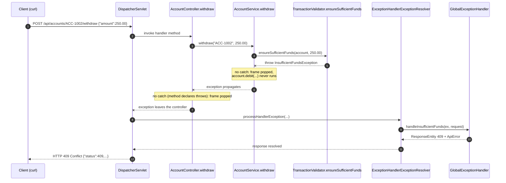

# java-exception-demo

A small **Java 21 + Spring Boot 3.5** banking and payments application that demonstrates Java exception handling end to end: the exception hierarchy, checked vs unchecked exceptions, try/catch/finally, custom exceptions, REST error handling, propagation through the call stack, debugging in IntelliJ IDEA, and testing.

| Document | What it is for |
|---|---|
| [README.md](README.md) | Setup, project structure, endpoints with curl examples, design decisions |
| [PRESENTATION_SCRIPT.md](PRESENTATION_SCRIPT.md) | Word-for-word script for the 25–35 minute screenshare |
| [DEBUGGING_GUIDE.md](DEBUGGING_GUIDE.md) | Exact breakpoint locations and what you will see in the IntelliJ debugger |
| [EXCEPTION_CHEATSHEET.md](EXCEPTION_CHEATSHEET.md) | Definitions, analogies, hierarchy diagram, comparison tables, interview Q&A |

---

## 1. Requirements

- JDK 21 (`java -version` should print 21.x)
- Maven 3.9+ (`mvn -v`)
- IntelliJ IDEA (Community or Ultimate)
- curl (built into Windows 10/11, macOS and Linux)

No database, no Docker, no Lombok. Everything is held in memory.

## 2. Build, test and run

```bash
# compile and run all 33 tests
mvn clean test

# start the application on http://localhost:8080
mvn spring-boot:run

# or build a runnable jar and start it
mvn clean package
java -jar target/java-exception-demo-1.0.0.jar
```

On start-up two demo accounts are created (see `config/DemoDataLoader.java`):

| Id | Owner | Opening balance |
|---|---|---|
| `ACC-1001` | Alice Johnson | 500.00 |
| `ACC-1002` | Bob Smith | 100.00 |

Accounts you create receive the next ids: `ACC-1003`, `ACC-1004`, ...
Data is lost on restart. **Restart the app before presenting** so the balances match the expected outputs below.

### Running in IntelliJ IDEA

1. **File → Open** and select the folder that contains `pom.xml`. Choose *Open as Project* and trust it.
2. Wait for Maven import to finish (progress bar bottom right). If the code shows red, open the Maven tool window and click **Reload All Maven Projects**.
3. **File → Project Structure → Project**: SDK = 21, language level = 21.
4. Open `ExceptionDemoApplication.java` and click the green ▶ in the gutter → **Debug 'ExceptionDemoApplication'** (use *Debug*, not *Run*, so breakpoints work).
5. Each class in `examples/` has its own `main` method. Click the green ▶ next to `main` to run it on its own, without Spring.
6. Run the tests by right-clicking `src/test/java` → **Run 'All Tests'**.

## 3. Project structure

```text
pom.xml
statements/ACC-1001.txt                 sample file read by the checked-exception demo
src/main/java/com/example/exceptions/
├── ExceptionDemoApplication.java       Spring Boot entry point
├── config/DemoDataLoader.java          seeds ACC-1001 and ACC-1002 (disabled in tests)
├── controller/                         HTTP layer
│   ├── AccountController.java          /api/accounts/**  (global handling, Approach B)
│   ├── TransferController.java         /api/transfers    (global handling, Approach B)
│   └── DemoController.java             /api/demo/**      (includes local try/catch, Approach A)
├── service/                            business logic, no HTTP knowledge
│   ├── AccountService.java             in-memory Map, BigDecimal money
│   ├── TransactionValidator.java       helper that throws on rule violations
│   └── StatementService.java           file reading (checked IOException)
├── model/Account.java
├── dto/                                Java 21 records: requests, responses, ApiError
├── exception/                          custom exceptions
│   ├── AccountNotFoundException.java   unchecked → 404
│   ├── InsufficientFundsException.java CHECKED   → 409
│   └── InvalidTransferException.java   unchecked → 400
├── handler/GlobalExceptionHandler.java @RestControllerAdvice
└── examples/                           DEMONSTRATION ONLY, plain main() programs
    ├── ExceptionHierarchyDemo.java     prints real superclass chains; propagation
    ├── UnhandledExceptionDemo.java     uncaught exception kills main, exit code 1
    ├── UncheckedExceptionExamples.java NPE, Arithmetic, AIOOBE, NumberFormat, IllegalArgument, IllegalState
    ├── CheckedExceptionExamples.java   IOException, FileNotFound, SQLException, ClassNotFound
    ├── ErrorExamples.java              controlled StackOverflowError and OutOfMemoryError
    ├── TryCatchDemo.java
    ├── MultipleCatchDemo.java
    ├── FinallyDemo.java
    ├── ThrowVsThrowsDemo.java
    ├── TryWithResourcesDemo.java
    └── ExceptionChainingDemo.java
src/test/java/com/example/exceptions/
├── service/AccountServiceTest.java              plain JUnit 5 unit tests
├── controller/AccountControllerTest.java        @WebMvcTest + Mockito (@MockitoBean)
├── controller/BankingApiIntegrationTest.java    @SpringBootTest, full stack, no mocks
└── examples/ExamplesTest.java                   proves every demo behaves as documented
```

**Production-style code** is everything outside `examples/`. **Demonstration-only code** is in `examples/` and in `DemoController`. Those classes break things on purpose and sometimes catch broadly so that one run can show several failures. Each one is labelled `DEMONSTRATION ONLY`.

## 4. Endpoints and curl examples

Commands are shown for **Git Bash, macOS or Linux**. In **Windows PowerShell** use `curl.exe` instead of `curl`, and wrap JSON in single quotes with inner double quotes escaped, e.g. `-d '{\"amount\":100.00}'`. The simplest option on Windows is to run the commands in Git Bash or IntelliJ's terminal set to Git Bash.

Every error uses the same JSON shape (`dto/ApiError.java`):

```json
{"timestamp":"2026-10-19T10:08:37.074Z","status":404,"error":"Not Found","message":"Account ACC-9999 was not found","path":"/api/accounts/ACC-9999"}
```

The outputs below were captured from the running application, in this order, straight after a fresh start. Timestamps will differ.

### Accounts

```bash
# 200 - get an account
curl -i http://localhost:8080/api/accounts/ACC-1001
# {"id":"ACC-1001","ownerName":"Alice Johnson","balance":500.00}

# 404 - AccountNotFoundException
curl -i http://localhost:8080/api/accounts/ACC-9999
# {"timestamp":"...","status":404,"error":"Not Found","message":"Account ACC-9999 was not found","path":"/api/accounts/ACC-9999"}

# 201 - create an account (Location header: /api/accounts/ACC-1003)
curl -i -X POST http://localhost:8080/api/accounts -H "Content-Type: application/json" \
     -d '{"ownerName":"Charlie Brown","openingBalance":250.00}'
# {"id":"ACC-1003","ownerName":"Charlie Brown","balance":250.00}

# 400 - IllegalArgumentException from the service
curl -i -X POST http://localhost:8080/api/accounts -H "Content-Type: application/json" \
     -d '{"ownerName":"","openingBalance":10}'
# {"timestamp":"...","status":400,"error":"Bad Request","message":"Owner name is required","path":"/api/accounts"}

# 200 - check balance
curl -i http://localhost:8080/api/accounts/ACC-1002/balance
# 100.00
```

### Deposit and withdraw

```bash
# 200 - deposit
curl -i -X POST http://localhost:8080/api/accounts/ACC-1001/deposit -H "Content-Type: application/json" -d '{"amount":100.00}'
# {"id":"ACC-1001","ownerName":"Alice Johnson","balance":600.00}

# 400 - negative amount (IllegalArgumentException from TransactionValidator)
curl -i -X POST http://localhost:8080/api/accounts/ACC-1001/deposit -H "Content-Type: application/json" -d '{"amount":-50}'
# {"timestamp":"...","status":400,"error":"Bad Request","message":"Amount must be greater than zero but was -50","path":"/api/accounts/ACC-1001/deposit"}

# 400 - fractions of a penny are rejected
curl -i -X POST http://localhost:8080/api/accounts/ACC-1001/deposit -H "Content-Type: application/json" -d '{"amount":1.005}'
# {"...","status":400,"message":"Amount must not have more than 2 decimal places but was 1.005", ...}

# 400 - malformed JSON (HttpMessageNotReadableException)
curl -i -X POST http://localhost:8080/api/accounts/ACC-1001/deposit -H "Content-Type: application/json" -d '{bad json'
# {"...","status":400,"message":"Request body is missing or is not valid JSON", ...}

# 200 - withdraw
curl -i -X POST http://localhost:8080/api/accounts/ACC-1002/withdraw -H "Content-Type: application/json" -d '{"amount":30.00}'
# {"id":"ACC-1002","ownerName":"Bob Smith","balance":70.00}

# 409 - InsufficientFundsException (propagates Validator -> Service -> Controller -> handler)
curl -i -X POST http://localhost:8080/api/accounts/ACC-1002/withdraw -H "Content-Type: application/json" -d '{"amount":250.00}'
# {"timestamp":"...","status":409,"error":"Conflict","message":"Account ACC-1002 has insufficient funds for an amount of 250.00","path":"/api/accounts/ACC-1002/withdraw"}
```

### Transfers

```bash
# 200 - successful transfer (after the deposit and withdrawal above: ACC-1001 = 600.00, ACC-1002 = 70.00)
curl -i -X POST http://localhost:8080/api/transfers -H "Content-Type: application/json" \
     -d '{"fromAccountId":"ACC-1001","toAccountId":"ACC-1002","amount":50.00}'
# {"from":{"id":"ACC-1001","ownerName":"Alice Johnson","balance":550.00},"to":{"id":"ACC-1002","ownerName":"Bob Smith","balance":120.00}}

# 400 - InvalidTransferException
curl -i -X POST http://localhost:8080/api/transfers -H "Content-Type: application/json" \
     -d '{"fromAccountId":"ACC-1001","toAccountId":"ACC-1001","amount":10}'
# {"...","status":400,"error":"Bad Request","message":"Cannot transfer money from account ACC-1001 to itself","path":"/api/transfers"}

# 409 - InsufficientFundsException (no money moves: both balances unchanged)
curl -i -X POST http://localhost:8080/api/transfers -H "Content-Type: application/json" \
     -d '{"fromAccountId":"ACC-1002","toAccountId":"ACC-1001","amount":5000}'
# {"...","status":409,"error":"Conflict","message":"Account ACC-1002 has insufficient funds for an amount of 5000","path":"/api/transfers"}

# 404 - AccountNotFoundException for the target account
curl -i -X POST http://localhost:8080/api/transfers -H "Content-Type: application/json" \
     -d '{"fromAccountId":"ACC-1001","toAccountId":"ACC-7777","amount":1}'
# {"...","status":404,"error":"Not Found","message":"Account ACC-7777 was not found","path":"/api/transfers"}
```

### Demonstration endpoints

```bash
# 400 - UNCHECKED: NumberFormatException, not caught anywhere, handled globally
curl -i http://localhost:8080/api/demo/unchecked
# {"...","status":400,"error":"Bad Request","message":"Value is not a valid number","path":"/api/demo/unchecked"}

# 200 - same endpoint with a valid number
curl -i "http://localhost:8080/api/demo/unchecked?amount=25.50"
# Parsed amount: 25.50

# 404 - CHECKED: FileNotFoundException caught LOCALLY in DemoController (Approach A)
curl -i http://localhost:8080/api/demo/checked
# {"...","status":404,"error":"Not Found","message":"No statement is available for account ACC-9999","path":"/api/demo/checked"}

# 200 - statement file exists (statements/ACC-1001.txt)
curl -i "http://localhost:8080/api/demo/checked?accountId=ACC-1001"
# STATEMENT FOR ACC-1001 (Alice Johnson) ...

# 500 - unexpected NullPointerException -> catch-all handler, no internal details leaked
curl -i http://localhost:8080/api/demo/unexpected
# {"...","status":500,"error":"Internal Server Error","message":"An unexpected error occurred. Please try again later.","path":"/api/demo/unexpected"}
```

### Framework errors use the same shape too

```bash
curl -i http://localhost:8080/api/nothing-here          # 404 "No endpoint exists at this path"
curl -i -X DELETE http://localhost:8080/api/accounts/ACC-1001   # 405 "HTTP method DELETE is not supported here"
```

## 5. Exception policy: who catches what

| Layer | Responsibility | Example |
|---|---|---|
| **Helper / validator** | **Detect** a broken rule and **throw** a meaningful exception | `TransactionValidator.ensureSufficientFunds` throws `InsufficientFundsException` |
| **Service** | **Propagate**. Do not catch what you cannot handle. Declare checked exceptions with `throws`. | `AccountService.withdraw(...) throws InsufficientFundsException` |
| **Controller** | **Propagate** (default). Catch locally **only** when this endpoint needs a response that differs from the global rule. | `DemoController.checked` catches `FileNotFoundException` → 404 |
| **GlobalExceptionHandler** | **Translate** exceptions to HTTP status + `ApiError`, and **log** them once | `InsufficientFundsException` → 409 |

Rules this code follows:

- **No swallowed exceptions.** Every catch block either returns a meaningful response or logs (or both). The catch-all handler logs the full stack trace server-side.
- **No internal details leak.** Clients receive `ApiError` only: no stack traces, no class names. The 500 handler always returns a generic message. `server.error.include-*` settings in `application.properties` are a second line of defence.
- **Exceptions are not used for normal control flow.** When "not found" is a normal outcome, `AccountService.findAccount` returns `Optional`. `getAccount` throws only because callers expect the account to exist.
- **Prevention before catching.** Amounts are validated *before* any balance changes, so a failed transfer cannot leave accounts half-updated.
- **Checked vs unchecked.** `InsufficientFundsException` is checked because it is an expected business outcome that callers must consciously handle. `AccountNotFoundException` and `InvalidTransferException` are unchecked because they represent bad input that no intermediate layer can fix.

## 6. Local vs global exception handling

| | Local try/catch (Approach A) | Global `@RestControllerAdvice` (Approach B) |
|---|---|---|
| Where | Inside the controller or service method | One class for the whole application |
| Good for | A response unique to one endpoint; recovering and continuing (fallback, retry, default value) | Consistent mapping of exception type → HTTP status everywhere |
| Pros | Explicit and visible right next to the code; full access to local variables | Controllers stay clean; no duplication; one JSON shape; one place to log; impossible to forget a case |
| Cons | Duplicated across endpoints; easy to be inconsistent; clutters business code | Further away from the failing code; one handler change affects every endpoint |
| In this project | `DemoController.checked` | `GlobalExceptionHandler` for everything else |

## 7. Implementation decisions

- **`BigDecimal` for money.** `double` cannot represent 0.10 exactly (`0.1 + 0.2 = 0.30000000000000004`). Amounts are compared with `compareTo`, not `equals`, because `equals` treats `1.0` and `1.00` as different.
- **Records for DTOs.** Immutable, concise, and Jackson supports them out of the box.
- **The model is never returned directly.** `AccountResponse.from(account)` keeps the API contract separate from the internal model.
- **`synchronized` on money-moving methods.** This stops two concurrent withdrawals from both passing the funds check. It is fine for an in-memory demo. A real system would use database transactions.
- **Explicit names in `@PathVariable("id")` and `@RequestParam(name = ...)`.** Spring otherwise relies on the `-parameters` compiler flag. If a class is compiled without it (for example, by an IDE that is not delegating to Maven), the request fails with a confusing error.
- **`@MockitoBean`** (Spring Framework 6.2+) replaces the deprecated `@MockBean`.
- **Caveat about the `IllegalArgumentException` handler.** Spring itself sometimes throws `IllegalArgumentException`. Our handler maps all of them to 400 and returns the exception message. In a larger system you would throw your own `ValidationException` and keep the generic `IllegalArgumentException` handler message-free.

## 8. Exception propagation (Controller → Service → Helper)



See [DEBUGGING_GUIDE.md](DEBUGGING_GUIDE.md) §5 for how to watch this happen in the debugger.
